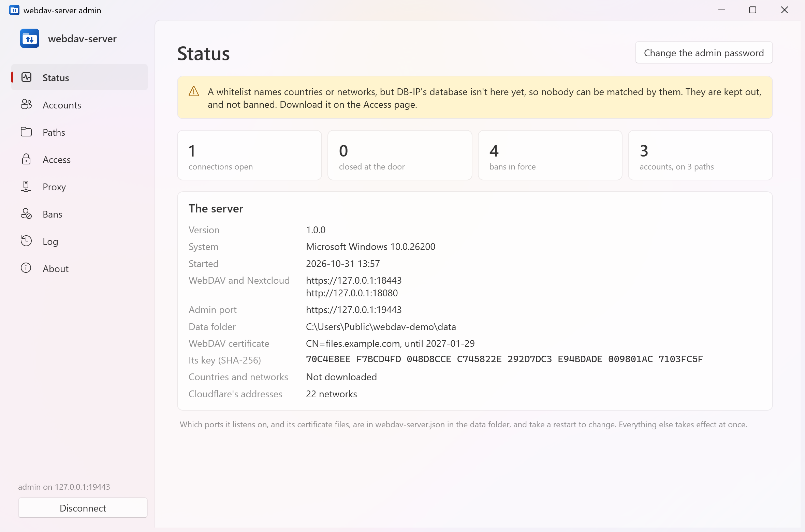
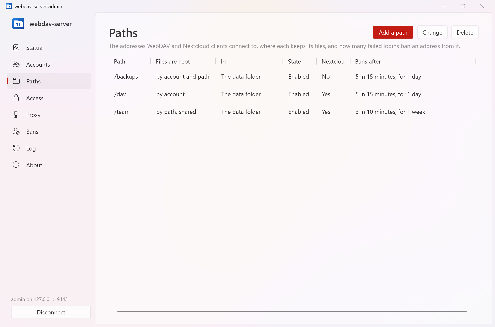
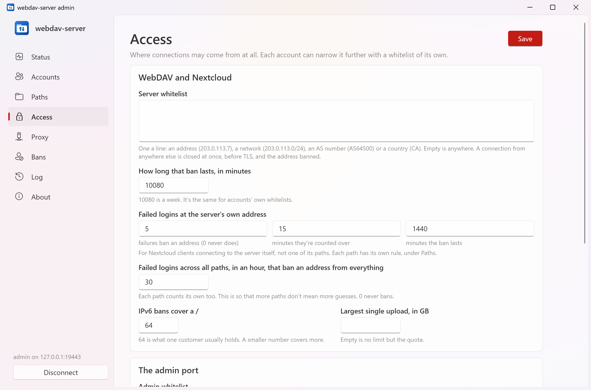
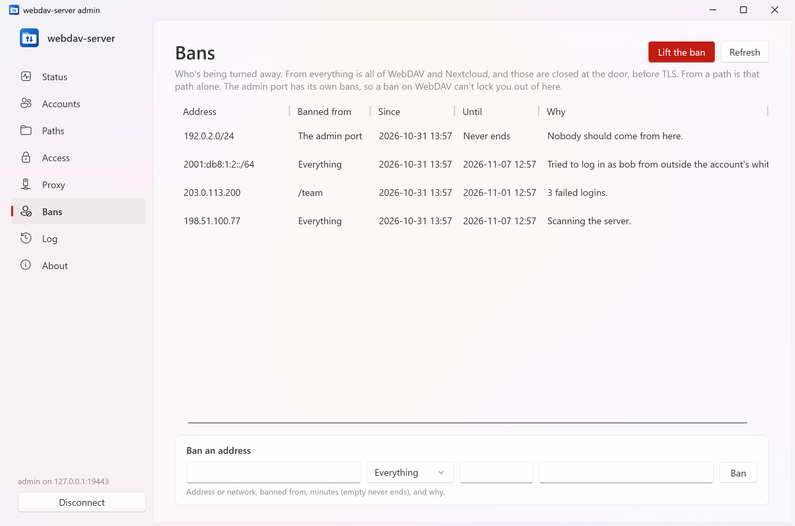
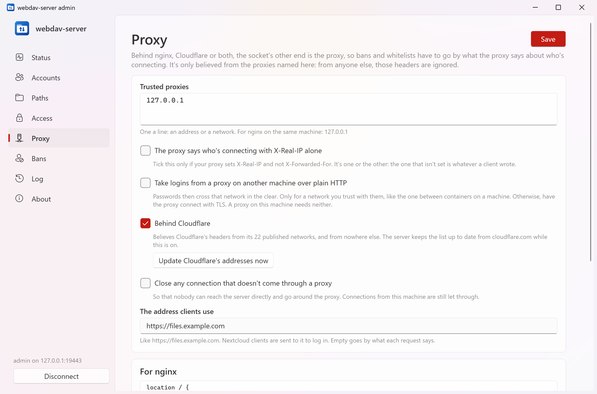
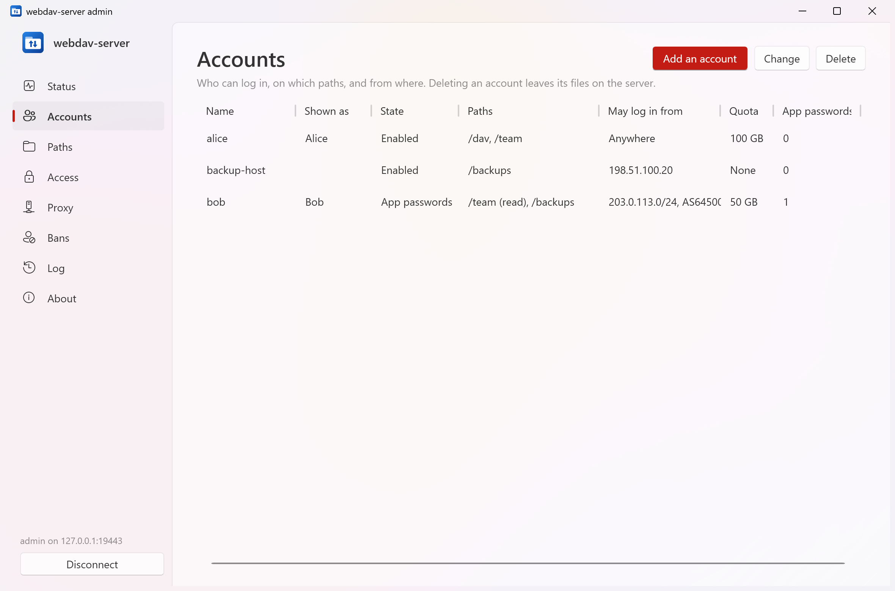
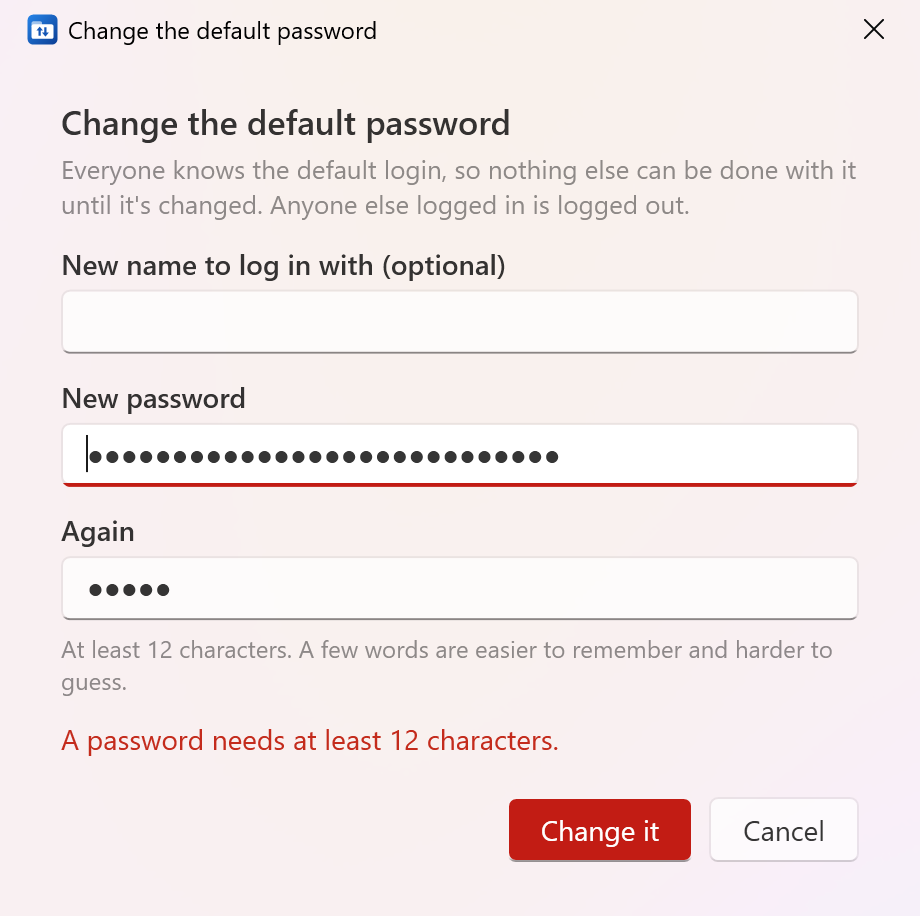

# webdav-server

[](https://github.com/strongthium/webdav-server/actions/workflows/release.yml)
[](https://github.com/strongthium/webdav-server/releases/latest)
[](LICENSE)

`webdav-server` is a file server of your own, for Linux and Windows. WebDAV clients and Nextcloud clients connect to the same
address and get the same files. You decide whether files are kept by account, by path or by both, how many failed logins ban an
address from each path, and where each account, or anyone at all, may connect from. Everything else is turned away: the socket is
closed before a byte of TLS, and the address is banned.

It's one small program with nothing to install, and a window for Windows, `webdav-server-admin`, that looks after it from across the
network. It runs on your own machine, and sends nothing about your files anywhere.

**In short:** self-hosted WebDAV server (RFC 4918, class 1 and 2), Nextcloud-compatible sync server, upload, download and sync by
user and/or path, per-path login failure bans, IP, ASN and country whitelists for each account and the whole server, Argon2id
passwords, app passwords, TLS 1.2 and 1.3 only, works behind nginx and Cloudflare, with a Windows admin GUI.



The pictures are of made-up data, using only the names and addresses set aside for documentation.

## Paths, and where files go

A **path** is an address clients connect to: `/team`, or `/` for the server's own address. Each keeps its files in one of three ways:

| Files are kept | What it means | On disk |
|---|---|---|
| **By account** | Each account has its own, the same on every path kept this way | `files/users/alice/` |
| **By path** | Everyone allowed on the path shares one set of files | `files/paths/team/` |
| **By both** | Each account has its own, on this path alone | `files/paths/team/alice/` |

`files/` is in the data folder, or a path can have a folder of its own anywhere on the server. An account may use the paths it's given,
each read and write or read only. Quotas are per account where files are kept by account, and per path where they're shared.



## WebDAV and Nextcloud, on one address

There's no `/nc/` to remember. The addresses a Nextcloud client uses are fixed names (`/status.php`, `/remote.php/…`, `/ocs/…`,
`/index.php/login/…`), which can't be the name of a path, and aren't files at the top of a path that serves Nextcloud clients. So
all of these are the same file:

```
https://files.example.com/team/report.pdf                                 WebDAV
https://files.example.com/team/remote.php/webdav/report.pdf               Nextcloud, at the path
https://files.example.com/remote.php/dav/files/alice/report.pdf           Nextcloud, at the server's own address
```

Give a Nextcloud client `https://files.example.com/team`, or just `https://files.example.com` for the path set as the account's home.
Files go through one piece of code however they're reached, so a lock taken over WebDAV holds against a Nextcloud client, and tags,
ids and quotas are the same either way. A path can be set to WebDAV alone.

**WebDAV:** RFC 4918 class 1 and 2: `GET`, `PUT`, `DELETE`, `MKCOL`, `COPY`, `MOVE`, `PROPFIND`, `PROPPATCH`, `LOCK`, `UNLOCK`, byte ranges,
conditional requests, and the quota properties of RFC 4331. A client's file times are kept, and `PUT`s are atomic: nobody sees half a file, and
someone downloading the old one carries on with the old one.

**Nextcloud:** `status.php`, capabilities and the user over OCS, the login flow that gives a client an app password (version 2, and
the older one mobile apps use), chunked uploads (version 2), checksums, file ids that survive a move, and tags that change on every
folder above a change, which is how sync clients find what's new.

**What isn't here:** sharing links, versions, a trash, a web page of files, and every Nextcloud app. Clients ask for these, are told calmly
that they aren't here, and carry on. Sync goes by tags and times: RFC 6578's sync reports aren't here either.

## Logging in, and being kept out

### Failed logins

Each path has its own rule: how many failures, over how long, ban an address from that path, and for how long. `0` never bans. One address
trying many accounts counts as one attacker, and logging in successfully doesn't clear the count, or one good account would give endless
tries. Accounts themselves are never locked, since that would let anyone lock their owner out. IPv6 is banned by the `/64`, which one machine
can hold whole.

All paths count together as well: 30 failures in an hour, by default, ban the address from everything, so that more paths don't mean more guesses. A ban
from a path holds however the path is reached, Nextcloud's addresses at the top of the server included.

### Whitelists

The whole server and each account can have a whitelist of addresses, networks, AS numbers and countries, one a line:

```
203.0.113.7
2001:db8::/32
AS64500
CA
```

| | From outside it |
|---|---|
| **Server** | The connection is closed the moment it's accepted, before TLS and before a byte is read, with a reset, so the socket is freed at once. The address is banned from all of WebDAV for a week, which you can change |
| **Account** | Even the right password fails. It's checked before the password, the connection is closed the same way, and the address is banned from all of WebDAV |

Countries and AS numbers go by [DB-IP](https://db-ip.com)'s free databases, about 12 MB, kept on the server: no address is ever sent anywhere to be
looked up. Until they're downloaded, rules like that can't match anyone, and connections they'd have to allow are closed but not banned, since it
isn't the client's fault. Status says so. Banned addresses are shut out the same way, at the door. A ban on WebDAV doesn't touch the admin port, and
the other way round.

Cutting off a login from outside an account's whitelist, as asked for, does tell whoever tries it that the account exists and has a whitelist,
at the price of their address.





### Passwords

Basic authentication over TLS, which is what every WebDAV client can do, and much stronger than Digest, which needs MD5 and a password
the server can read.

- **TLS only.** TLS 1.2 and 1.3. A login over plain HTTP is refused unless it's from this machine or a proxy that says the client's own connection was TLS.
- **Argon2id** for passwords, with 64 MiB and three passes. A wrong name takes as long as a wrong password. Checked passwords are remembered for five minutes as a keyed hash under a key that only exists in memory, since WebDAV logs in on every request.
- **App passwords**, one for each device, each of which can be taken away alone. An account can be set to log in with nothing else. They're 178 random bits, so a plain SHA-256 is all that's kept, and they're shown once. One can't be used to make another, so a leaked one doesn't outlive being taken away.

### What else stands in the way

| | |
|---|---|
| **Staying in its own files** | Paths are read from the raw request and every segment is checked, so `%2e%2e`, `%2f`, `%5c` and `%00` get nowhere. On Windows, so do alternate data streams, device names and short names like `WEBDAV~1`. Symbolic links and junctions are never followed or listed, whoever made them |
| **XML** | No DTDs, so no entity bombs and no XXE. No resolver. 1 MiB at most |
| **Uploaded files** | Always served as downloads, with `nosniff` and a sandboxing CSP, so uploaded HTML can't run from this address |
| **Running out of things** | `PROPFIND` with infinite depth is refused. Limits on connections, headers, hashing at once, locks and properties. Quotas hold as a file arrives, even with no declared length |
| **Other people's locks** | A lock token only counts from the account that took the lock |
| **The login page** | Only for Nextcloud's login flow. A strict CSP, nothing from elsewhere, and it says plainly what's being given to whom, because someone who sends you a link to it is after your files. Posts from other sites are refused, so a web page can't get its visitors banned |
| **Unfinished uploads** | Each account's are its own, even on a shared path. They count against the quota, and go after two days |
| **The data folder** | Readable only by the server's account. It can't be served as a path, however its name is written: links and short names are followed first, and network paths aren't taken |

## Behind nginx and Cloudflare

Behind a proxy, the socket's other end is the proxy, so bans and whitelists go by what the proxy says about who's connecting. That's only believed from
proxies named on the **Proxy** page, or Cloudflare by its published addresses. From anyone else `X-Forwarded-For` and friends are ignored, and anyone
can write them. `X-Forwarded-For` is read from the right, so what a client adds to the left of it gets nowhere, and `CF-Connecting-IP` only counts
when the address that passed the request on really is Cloudflare's.

Logins are only taken if the password has been safe the whole way: the proxy has to say the client's own connection was TLS, and the stretch from the proxy to here has to be TLS too or stay on this
machine. For a proxy on another machine over a network you trust with passwords, like the one between containers, there's a setting that allows that last stretch in the clear.



**nginx:** [`deploy/nginx.conf`](deploy/nginx.conf) has what it takes. The server listens in the clear on the loopback address, and `127.0.0.1` goes on
the trusted list. Make sure it sets `X-Forwarded-For` and `X-Forwarded-Proto` as that file does, since a client's own values pass straight through a proxy that doesn't. If yours can only
send `X-Real-IP`, tick the setting that says so: it's one header or the other, and the other is ignored.

**Cloudflare:** set SSL/TLS to **Full (strict)**. Flexible sends everything between Cloudflare and the server in the clear, so logins are refused. Free plans
limit a request to 100 MB: Nextcloud clients upload in chunks and get past that, and other WebDAV clients can't. Whether Cloudflare's rules let every
WebDAV method through depends on your zone, so try yours.

**Both:** name nginx, and tick Behind Cloudflare.

**Close any connection that doesn't come through a proxy** stops people going around it. The firewall is still the better place for that.

Behind a proxy the server can't close the client's own socket, only its own side. Over HTTP/1.1 that closes the connection to the proxy, and the client gets
an error from the proxy. Over HTTP/2 other people's requests may be on the same connection, so only that request is cut. A banned client costs the proxy
more than it would cost the server alone: for that, ban it at the proxy too.

## The admin window

`webdav-server-admin` runs on Windows 10 and 11, and looks after a server on Linux or Windows over its own port, 9443, which is always TLS and never serves files.



**The first time:** connect to the server, as `admin` with the password `admin`. You're shown the server's certificate key, to compare with what the server printed when it
started. Then you have to change the password, and nothing else can be done until you have.



Everyone knows a default password, so until it's changed it only works from the server itself or a private network. On a server you reach over the internet, connect through an SSH
tunnel, or set the password on the server:

```
ssh -L 9443:localhost:9443 you@your-server      # then connect the window to localhost
sudo -u webdav-server -H webdav-server --set-admin-password
```

`"allowDefaultAdminPasswordFromAnywhere": true` in `webdav-server.json` lifts this, if you must. The admin port listens on every address by default, so it's worth closing it in the firewall,
giving it a whitelist on the **Access** page, or setting `"admin": { "address": "127.0.0.1", "port": 9443 }`.

The window keeps the server's certificate key, and warns you if it ever changes. No password is saved. The login lasts until 30 minutes of silence, and 8 hours at most. Five wrong passwords ban
the address from this port for an hour, and it won't let you save a whitelist or a ban that would shut you out.

| Page | What's on it |
|---|---|
| **Status** | What ought to be looked at, connections, bans, addresses, the certificate |
| **Accounts** | Who can log in, on which paths and from where, quotas and app passwords |
| **Paths** | Where each keeps its files, and how many failures ban an address |
| **Access** | The server's and the admin port's whitelists, ban lengths, DB-IP's files |
| **Proxy** | Trusted proxies, Cloudflare, and the address clients use |
| **Bans** | Who's turned away and why: lift a ban, or add one |
| **Log** | Logins, failures, bans and changes. 90 days, and never a password |

**If you shut yourself out**, with the server stopped, on the server:

```
webdav-server --reset-admin        # back to admin / admin, with the admin whitelist and admin bans cleared
webdav-server --unban 203.0.113.7  # lifts every ban on an address
webdav-server --fingerprint        # shows the admin port's certificate key
```

## Running it

You need the [ASP.NET Core 10 Runtime](https://dotnet.microsoft.com/download/dotnet/10.0) for the server, and the .NET 10 Desktop Runtime for the window. Download a zip from
[Releases](../../releases/latest), or take a file straight from [`public/`](public), which always holds the latest build:

| File | What it is |
|---|---|
| `webdav-server-linux-x64-needs-dotnet` | the server, for Linux |
| `webdav-server-win-x64-needs-dotnet.exe` | the server, for Windows |
| `webdav-server-admin-win-x64-needs-dotnet.exe` | the window, for Windows 10 and 11 |

**On Linux,** as a service with an account of its own and no way to touch anything but its data, using [`deploy/webdav-server.service`](deploy/webdav-server.service):

```
sudo useradd --system --home-dir /var/lib/webdav-server --shell /usr/sbin/nologin webdav-server
sudo install -m 755 webdav-server-linux-x64-needs-dotnet /usr/local/bin/webdav-server
sudo cp webdav-server.service /etc/systemd/system/
sudo systemctl daemon-reload
sudo systemctl enable --now webdav-server
sudo journalctl -u webdav-server            # shows the admin port's certificate key
```

**On Windows,** as a service, from an administrator's prompt:

```
sc.exe create webdav-server binPath= "C:\Program Files\Strongthium\webdav-server.exe" start= auto
sc.exe start webdav-server
```

Or just run it, to try it: `webdav-server --data D:\webdav`. WebDAV is on port 8443 and the admin port on 9443.

**Everything is in one folder:** `/var/lib/webdav-server` on Linux, `%ProgramData%\Strongthium\webdav-server` on Windows, or wherever `--data` says. Back it up and you have the lot. What can't change while
the server runs is in `webdav-server.json` there; the rest is in the database, and is in force the moment it's saved.

```json
{
  "listen": [
    { "address": "*", "port": 443, "tls": true }
  ],
  "admin": { "address": "*", "port": 9443 },
  "certificateFile": "/etc/letsencrypt/live/files.example.com/fullchain.pem",
  "keyFile": "/etc/letsencrypt/live/files.example.com/privkey.pem",
  "maxConnections": 4096
}
```

With no certificate named, a self-signed one is made. Many WebDAV clients, and Windows Explorer among them, won't connect to one, so give it a real one. It's read again when it changes, so a renewal takes no
restart. The admin port always keeps its own, which the window pins.

**What's kept in memory** ends with a restart: locks, which time out anyway, and logins through the window. Files put directly in the folders on the server are seen, but only change the tag of the folder they're
in, so a sync client may not look there until something above it changes too. Let clients do the writing. Subfolders report no size to Nextcloud clients, which only use it to ask about syncing very large folders.

`webdav-server --about` says who makes it and whether there's a newer version, and `--update` installs it, asking first unless `--yes` is given. The window's **About** does the same for the window.

## What's sent where

| To | What | When |
|---|---|---|
| `download.db-ip.com` | A request for the month's files | A whitelist names a country or AS number, or you press Download. Monthly after that, unless turned off |
| `www.cloudflare.com` | A request for its list of addresses | Behind Cloudflare is ticked. Daily after that |
| `api.github.com` | The question of what the latest version is | Only from `--about`, `--update`, or the window's About |

Nothing else, and never a file, a name or an address.

## Building

You need Windows and the [.NET 10 SDK](https://dotnet.microsoft.com/download).

```
.\build.ps1                 # tests, then the programs into public\  (or double-click build.cmd)
.\build.ps1 -Bump patch     # the same as a new version: 1.0.0 -> 1.0.1
```

`build.ps1` runs the tests (`-SkipTests` skips them), publishes the programs, and replaces what's in [`public/`](public) with them, their `SHA256SUMS` and the `VERSION` they were built as.

For working on it:

```
dotnet test --project tests/WebDavServer.Tests/WebDavServer.Tests.csproj
dotnet run --project src/WebDavServer -- --data D:\webdav-test
dotnet run --project src/WebDavServer.Admin
```

| Folder | What's in it |
|---|---|
| [`src/WebDavServer`](src/WebDavServer) | the server: the door and proxies (`Network`), logins and bans (`Security`), WebDAV (`Dav`), Nextcloud (`Nextcloud`), files and the database (`Storage`), and the admin port (`Admin`) |
| [`src/WebDavServer.Admin`](src/WebDavServer.Admin) | the window (WPF, with its Fluent theme) |
| [`src/WebDavServer.Shared`](src/WebDavServer.Shared) | what the two say to each other, whitelists, and updating |
| [`tests/WebDavServer.Tests`](tests/WebDavServer.Tests) | tests that start the real server on the loopback address and talk to it over real sockets, so that what they see closed really is closed, and the attacks that have been tried on it. The release workflow runs them on Windows and on Linux |
| [`deploy`](deploy) | a systemd unit, and a configuration for nginx |
| [`public`](public) | the latest build, made by `build.ps1` |

`master` holds the source. A push to `deploy` (a merge into it counts) runs [`.github/workflows/release.yml`](.github/workflows/release.yml), which runs the tests on Windows and Linux, builds the three programs, and publishes release
`v<VERSION>` with their zips and `SHA256SUMS`. A version is released once: to release again, raise it first.

## Reporting a vulnerability

Please don't open a public issue. The [security policy](https://github.com/strongthium/.github/blob/main/SECURITY.md) explains how to report one privately.

## License

MIT, see [LICENSE](LICENSE). Built on [Konscious.Security.Cryptography.Argon2](https://github.com/kmaragon/Konscious.Security.Cryptography) (MIT) and Microsoft.Data.Sqlite (MIT). The address data is [DB-IP](https://db-ip.com)'s, under CC BY 4.0, and is downloaded, not included.
